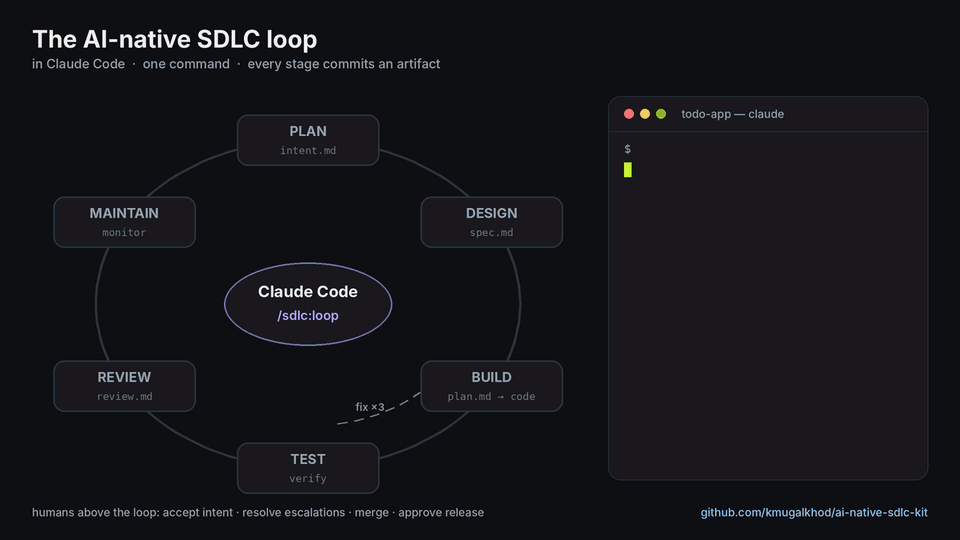
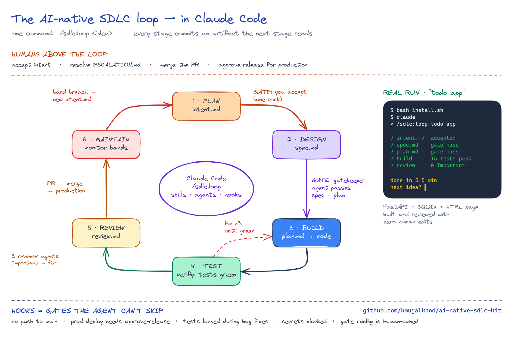
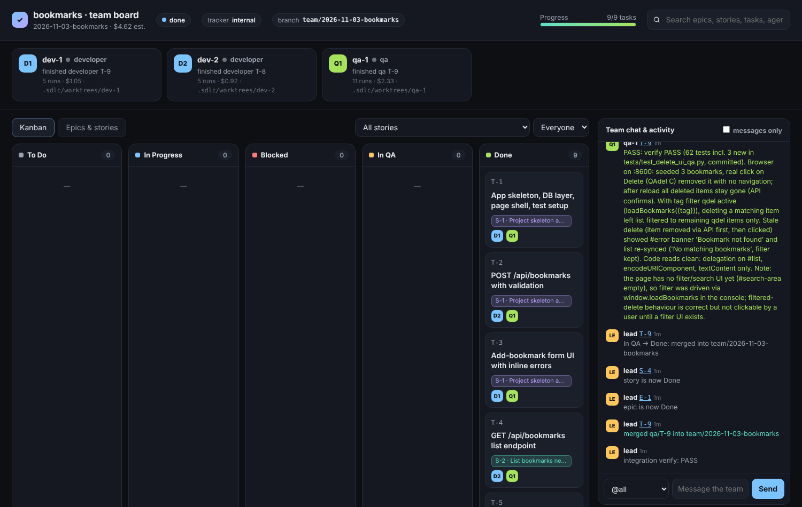

# AI-Native SDLC for Claude Code

A Claude Code plugin (`sdlc`) that runs Anthropic's *AI-Native SDLC Playbook* end to end:
**Plan → Design → Build → Test → Deploy → Maintain**, as a loop. Every stage commits an artifact the
next stage reads; skills carry policy; hooks are the deterministic gates; evals regression-test the
agent's config; control bands close the loop by writing the next `intent.md`.



```bash
claude plugin marketplace add kmugalkhod/ai-native-sdlc-kit && claude plugin install sdlc@ai-native-sdlc
```
Then in any folder: `claude` → `/sdlc:loop <your idea>`.



## Install

**Quickest:** unzip, then inside the folder run `bash install.sh` (Windows PowerShell: `powershell -ExecutionPolicy Bypass -File install.ps1`) — or open Claude Code in the folder and say *"install this plugin"*. See INSTALL.md.

**Requirements:** Claude Code, git, Python 3.8+ (`python3`, or `python` on Windows Git Bash).
Optional: PyYAML (monitor), `gh` / `glab` (PR/MR steps).

### 1. Add the marketplace and install the plugin (once per machine)
```bash
claude plugin marketplace add kmugalkhod/ai-native-sdlc-kit && claude plugin install sdlc@ai-native-sdlc
```
If the repo is private, make sure `git clone https://github.com/kmugalkhod/ai-native-sdlc-kit` works for you first
(GitHub CLI login or a credential helper). Alternatives:
```bash
# from a local clone
git clone https://github.com/kmugalkhod/ai-native-sdlc-kit && claude plugin marketplace add "$PWD/ai-native-sdlc-kit" && claude plugin install sdlc@ai-native-sdlc
# try it for one session without installing
claude --plugin-dir ./ai-native-sdlc-kit/plugins/sdlc
```
Inside Claude Code you can also run `/plugin marketplace add kmugalkhod/ai-native-sdlc-kit` then `/plugin install sdlc@ai-native-sdlc`.

Check: start `claude` and type `/sdlc:` — the commands should be listed.
Update later: `claude plugin marketplace update ai-native-sdlc`.

### 2. Model access — pick one
The plugin and every script call the `claude` CLI, so they use whatever Claude Code is signed in with.

| Where | Claude subscription (Pro / Max / Team / Enterprise) | Claude API key | AWS Bedrock |
|---|---|---|---|
| Your machine (interactive + `pipeline.py` / `evals.py` / `monitor.py`) | `claude auth login` (or `/login`) — nothing else | `export ANTHROPIC_API_KEY=...` | `export CLAUDE_CODE_USE_BEDROCK=1 AWS_REGION=<region>` |
| GitHub Actions | `claude setup-token` locally → repo secret `CLAUDE_CODE_OAUTH_TOKEN` | secret `ANTHROPIC_API_KEY` | uncomment the Bedrock block in each workflow |
| GitLab CI | masked variable `CLAUDE_CODE_OAUTH_TOKEN` | masked variable `ANTHROPIC_API_KEY` | `CLAUDE_CODE_USE_BEDROCK=1`, `AWS_REGION` + runner role |

Notes:
- With a subscription, headless runs count against your plan's usage limits instead of API billing; the `cost $` the scripts print is an estimate.
- A subscription token belongs to the person who created it — fine for your own repos; use an API key for team-shared CI.
- Models are set per stage in `.sdlc/config.json → models` (default `sonnet`). On a Max plan you can set e.g. `"plan": "opus"`; on Bedrock-only Sonnet/Haiku setups leave the defaults.

### 3. Set up a repo (once per repo)
```bash
cd your-app-repo && claude
```
then run `/sdlc:init github` (or `gitlab` / `none`) and commit what it creates.

## Quick start — one command

```bash
mkdir my-app && cd my-app && claude
```
```text
/sdlc:loop todo app: add, list, mark done, delete todos. FastAPI + SQLite + simple HTML page
```
It sets the repo up if needed, then runs intent → spec → plan → build+test → review in the chat, asking you
**Accept / Change / Stop** at each gate and committing every artifact on its own branch. When it finishes it asks
for the next feature — that's the loop. Add `--auto` to let the gatekeeper agent take the spec/plan/review gates.

## Stage by stage (same thing, one command per stage)

```text
/sdlc:init gitlab            # scaffold: sdlc/changes, CLAUDE.md, REVIEW.md, .sdlc/ gates + CLI, evals, bands, CI
/sdlc:intent customers can't see claim status in the portal
                             # PO sets Status: accepted in intent.md, commits
/sdlc:spec claim-status      # requirements+design, policy skills applied, concerns flagged
                             # PO resolves concerns, sets Status: accepted
/sdlc:plan claim-status      # plan mode: files, order, tests, risks → plan.md; engineer accepts
/sdlc:build claim-status     # implement + verify until green; plan.md kept in sync; verifier agent
/sdlc:review claim-status    # 3 parallel passes (bugs/security/compliance) → review.md
/sdlc:babysit                # take the PR/MR to green; code owner approves + merges
/sdlc:status --metrics       # where every change is + playbook indicators from git
```
Also: `/sdlc:bugfix` (failing-test-first + test lock), `/sdlc:triage` (incident → intent.md),
`/sdlc:learn` (repeat mistake → CLAUDE.md), `/sdlc:evals run|add`.

## Playbook → kit

| Stage / play | Kit |
|---|---|
| 1 Plan · capture intent.md | `/sdlc:intent`, `.sdlc/templates/intent.md`, `sdlc.py new` |
| 2 Design · requirements & design | `/sdlc:spec` — loads every relevant policy skill, `- [ ]` flagged concerns |
| 3 Build · plan mode | `/sdlc:plan` → `plan.md` (no source edits until accepted) |
| 3 Build · auto mode / CLAUDE.md / skills | `/sdlc:build`, CLAUDE.md template, `/sdlc:learn`, `sdlc-artifacts` skill, `examples/skills/api-security` |
| 3 Build · hooks as guardrails | protected paths, secret scan, formatter/lint-on-edit, governance files locked |
| 3 Build · parallel sessions & subagents | `claude --worktree <name>` per task; agents `researcher`, `verifier`, `simplifier` |
| 4 Test · feedback loop | `sdlc.py verify`, CLAUDE.md "Verifying your work", `/sdlc:bugfix` + **fix mode** (test edits blocked) |
| 4 Test · continuous evals | `evals.py` (worktree per case, tests *uncommitted* config), `agent-evals.yml` / GitLab `sdlc:evals` |
| 5 Deploy · AI in PR review | `/sdlc:review` (3 reviewer agents), `REVIEW.md`, `claude-review.yml` (+ `@claude` fixes), GitLab `sdlc:review`, `/sdlc:babysit` |
| 5 Deploy · hooks as approval gates | production gate (needs `approve-release` by a human), no push to protected branches, audit log |
| 5 Deploy · CI/CD | `pipeline.py`, `sdlc-loop.yml`, GitLab `sdlc:loop`; `examples/managed-settings.json` |
| 6 Maintain · closing the loop | `monitor.py` + `bands.yaml` (Western Electric rules, tiers log/diagnose/propose, cooldown) → `/sdlc:triage` → intent.md |
| 6 Maintain · gates between stages | `gatekeeper` agent + deterministic checks; `ESCALATION.md` hands off to a human |
| Measure | `sdlc.py metrics`: intent→spec h, spec→plan h, rework after plan, survival rate |

## Agent team — Epic → Stories → Tasks, developers + QA, live kanban  *(beta)*



> **Beta.** The single-agent loop (`/sdlc:loop`) is the stable path. The agent team is new: it is tested with real
> Claude teammates on small projects and in CI on Linux, macOS and Windows, but not yet on many real codebases.
> Report what breaks.

```text
/sdlc:team <change>            # or: /sdlc:loop <idea> --team
```

**Fast mode — Claude Code Agent Teams (recommended).** Enable once in `~/.claude/settings.json`:
`{"env": {"CLAUDE_CODE_EXPERIMENTAL_AGENT_TEAMS": "1"}}`. Your Claude Code window becomes the **team lead** and
runs persistent teammates — `dev-1`, `dev-2`, `qa-1`, `designer` — that start once and keep their context for the
whole run. You watch and talk to each of them in the agent panel.

1. **Plan** — `breakdown.json`: one Epic, Stories, small file-disjoint Tasks with dependencies, acceptance
   criteria and a QA note; on the board and, if configured, in **Jira** or **Linear**.
2. **Prepare** — `team.py prepare` creates one git worktree per teammate, installs dependencies in all of them in
   parallel, and recovers anything an earlier session left behind.
3. **Assign by story** — `team.py next` (deterministic, < 1 s) hands each free developer a whole story — its ready
   tasks, in order, on one branch. The lead only relays the assignment; teammates never wait for bookkeeping.
4. **Develop** — in its own worktree: implement, test only what changed while working, one full verify at the
   end, commit, `board.py submit`. Scaffolding comes from generators.
5. **QA by story** — when a story is handed over, the lead starts the app on a free port and a QA teammate checks
   every acceptance criterion (API + one real-browser pass), adds tests, and gives a verdict per task. A failure
   goes back to the same developer — who still has the context. Pure setup tasks (`"qa": "none"`) are verified by
   the lead instead of a QA run.
6. **Merge by story** — a fully passed story merges into `team/<change>` in one go; conflicts go back to the
   developer. `team.py wrap` runs the full verify on the team branch and commits `team-report.md`. Nothing is pushed
   to main.

Blocked teammates get help from an idle one; repeated trouble escalates to you (*Resume with guidance* on the board,
or `board.py resume`). Design approval and resume are human-only: teammates act on the board as
`board.py --as <name>`, and a named agent can never approve.

A real run (4 tasks, 2 developers + QA, Sonnet teammates): planned → built → QA'd → merged in about 3 minutes,
integration verify green.

**Background mode** (Agent Teams off): `team.py run` starts a separate headless Claude per task — works unattended,
but slower (every task starts cold).

```bash
python3 .sdlc/bin/board_server.py                 # live board: http://127.0.0.1:8765
python3 .sdlc/bin/team.py plan <change>           # breakdown only
python3 .sdlc/bin/team.py prepare <change>        # agent-teams mode: worktrees + first assignments (JSON)
python3 .sdlc/bin/team.py next <change> --done dev-1   # next assignments after a teammate finished
python3 .sdlc/bin/team.py wrap <change>           # final verify + team report
python3 .sdlc/bin/team.py allow                   # pre-approve teammates' commands (push stays denied)
python3 .sdlc/bin/team.py run <change> --developers 3 --qa 1   # background mode
python3 .sdlc/bin/team.py status
```

Commands in `.sdlc/config.json` are made portable at run time: `npm --prefix DIR install` runs inside `DIR`, and
`.venv/bin/…` becomes `.venv\Scripts\…` on Windows — no per-OS config.

**Designer (UI changes only).** When any task changes what users see, the breakdown adds **D-1 Design**. A
designer agent, in its own worktree, uses the [impeccable](https://impeccable.style) skill:
- *greenfield* (no UI yet): `init` → PRODUCT.md, a new direction → **DESIGN.md**, `shape` each screen;
- *brownfield* (existing UI or DESIGN.md): the existing look is the standard — `document` generates DESIGN.md
  from the code if it's missing, and new screens reuse its tokens; no redesign.

It delivers `<change>/design/mockup.html` (every screen and state, desktop + mobile) and `design-notes.md`.
The board shows **Approve / Request changes**; only UI tasks wait, backend work continues. After approval the
design is merged, developers build to the mockup and QA compares the page against it. Backend-only changes skip
the designer. Install impeccable once: `/plugin marketplace add pbakaus/impeccable` then
`/plugin install impeccable@impeccable`. Without the team, run `/sdlc:design <change>` (also part of `/sdlc:loop`).

**The board page:** kanban (To Do · In Progress · Blocked · In QA · Done) with live "who is doing what" on each
card, epic/story/task tree with progress, search across everything, filters by story and agent, task detail with
full history, the team's chat and activity feed, and a box to message the agents.

**Configure per project** (`.sdlc/config.json`, human-owned):

```json
"team": {
  "developers": 2, "qa_agents": 1,
  "models": {"planner": "sonnet", "developer": "sonnet", "qa": "sonnet", "helper": "sonnet"},
  "max_qa_rounds": 3, "max_help_rounds": 2,
  "qa": {"start_cmd": ".venv/bin/uvicorn app.main:app --port {port}", "browser": "playwright-mcp"}
},
"tracker": {
  "type": "internal",                      // or "jira" / "linear"
  "jira":   {"base_url": "https://you.atlassian.net", "project_key": "PROJ"},
  "linear": {"team_key": "ENG", "epic_as": "project"}
}
```

| Tracker | Credentials (env) | Agents' MCP |
|---|---|---|
| internal | none | — |
| Jira | `JIRA_BASE_URL`, `JIRA_EMAIL`, `JIRA_API_TOKEN` | Atlassian Rovo MCP (`mcp.atlassian.com/v1/mcp`); API-token auth must be enabled by your Atlassian org admin |
| Linear | `LINEAR_API_KEY` | Linear MCP (`mcp.linear.app/mcp`) with the same key |

Sync is **hybrid**: the lead mirrors the board into Jira/Linear through their APIs (create, agent labels such as
`agent-dev-1`, status transitions by name, hand-off/QA/merge comments). Agents use the tracker's MCP to read
tickets and comment. Status names are configurable (`tracker.jira.transitions`, `tracker.linear.states`).
Agents aren't Jira/Linear users, so the assignee is a label; set `assignee_account_id` / `assignee_id` to also
assign a real (bot) account.

**Cost:** each teammate is its own Claude session, so 2 developers + 1 QA is roughly 3× the usage of one session
while they work in parallel. On a Pro plan start with `--developers 1`.

**Tests** (`.github/workflows/test.yml`, Linux · macOS · Windows): `tests/test_teamlead.py` drives a whole team run
with scripted teammates — story batching, design gate, a QA failure, a blocked task, a session crash and restart;
`tests/test_portable.py` runs the config commands for real (npm + venv); `tests/test_trackers.py` the Jira/Linear sync.

## Dependencies

The loop installs packages itself, through one command you control: `verify.setup` in `.sdlc/config.json`
(e.g. `python3 -m venv .venv && .venv/bin/pip install -q -r requirements.txt`, `npm ci`, `uv sync`).
The plan lists new packages under **Dependencies**; the build adds them to the manifest and runs
`sdlc.py verify`, which runs setup → build → test → lint. Ad-hoc `pip install` is not needed in headless runs;
to allow more commands there, add them to `pipeline.allowed_bash` (e.g. `"npx prisma generate"`).

## Governance model

- **Human-owned files**: `.sdlc/config.json`, `.sdlc/state/`, `.sdlc/bin/`, `.sdlc/audit.jsonl` — hooks block the agent from editing them (Edit/Write *and* shell). `protected_paths` default also covers `.claude/settings.json` and `REVIEW.md`.
- **Human-only actions** need an interactive terminal (the agent's Bash tool can't do them):
  - `python3 .sdlc/bin/sdlc.py fix-mode off`
  - `python3 .sdlc/bin/sdlc.py approve-release CHG-1234` (TTL from config; or launch with `RELEASE_APPROVAL=...`)
- **Production gate**: commands matching `prod_gate.patterns` are blocked without an approval (`mode: "ask"` prompts instead).
- **No direct push** to `protected_branches`; everything arrives as a PR/MR.
- **Audit**: every block/ask/allow-with-approval, gate verdict, fix-mode and release event → `.sdlc/audit.jsonl` (local; git history is the durable trail).
- All hooks are no-ops in repos without `.sdlc/config.json`, so installing the plugin globally is safe.

## Headless loop

The whole thing as one long-running command (Ctrl+C to stop):
```bash
python3 .sdlc/bin/loop.py                         # every 5 min: monitor → accepted intents → pipeline → repeat
python3 .sdlc/bin/loop.py --interval 120 --pr     # open a PR/MR per finished change
python3 .sdlc/bin/loop.py --auto-accept-intent    # fully autonomous demo: also accepts draft intents
python3 .sdlc/bin/loop.py --once                  # single tick for cron/CI
python3 .sdlc/bin/loop.py --retry <change>        # re-run a change after you fixed its ESCALATION.md
```
While it runs you just drop ideas in with `/sdlc:intent` (or `sdlc.py new`) and accept them; each one is picked up on the next tick and built on its own branch `sdlc/<change>`.

Individual pieces:
```bash
python3 .sdlc/bin/pipeline.py claim-status --to plan          # spec → gate → plan → gate, commits on sdlc/<change>
python3 .sdlc/bin/pipeline.py claim-status --from build --pr  # build → verify/fix ×3 → review/fix → PR/MR
python3 .sdlc/bin/pipeline.py claim-status --dry-run
python3 .sdlc/bin/monitor.py --dry-run                         # sample band breaches on first run
python3 .sdlc/bin/evals.py --case verify-before-done
```
Exit code 3 = escalated (see `ESCALATION.md`). The intent must already be accepted by a human; nothing passes the production gate.

## Models

Per-stage models live in `.sdlc/config.json → models` (defaults `sonnet`; researcher agent `haiku`). Works on a Claude subscription, the Claude API, or Bedrock with only Sonnet + Haiku. Switching a stage to `opus` is config only — no code change. Auth setup: see Install step 2.

## Layout

```
.claude-plugin/marketplace.json
plugins/sdlc/
  .claude-plugin/plugin.json
  skills/      init loop intent spec design plan build bugfix review babysit triage status learn evals team board sdlc-artifacts
  agents/      researcher verifier simplifier bug-reviewer security-reviewer compliance-reviewer gatekeeper designer
  hooks/       hooks.json run.sh
  scripts/     sdlc_core.py sdlc_hooks.py sdlc.py pipeline.py loop.py evals.py monitor.py init.py
               team.py board.py board_server.py trackers.py
  templates/   CLAUDE.md REVIEW.md .sdlc/ sdlc/ evals/ .claude/ .github/ .gitlab/ examples/
```

Windows: hooks run through `bash` (Git Bash) and find `python3` or `python`.
